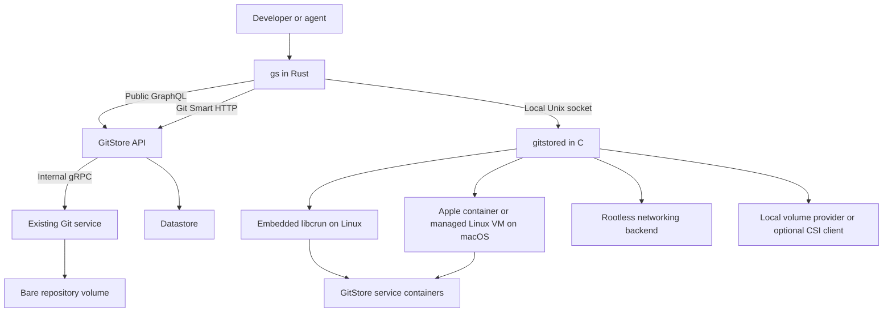

# GitStore CLI Product Requirements

- Status: Draft for product and architecture review
- Date: 26 October 2026
- Scope: `gs` CLI and `gitstored` service daemon

## Product direction

GitStore needs one automation-friendly interface for working with catalogues and running GitStore services. Developers and agents should be able to authenticate, manage resources, synchronise repositories, export admitted state, and operate a deployment without opening the Admin UI.

Build `gs` in **Rust** and `gitstored` in **C**, following the project preference. `gs` uses the public GraphQL API for platform operations and Git for repository workflows. It connects to `gitstored` through a local socket for service lifecycle operations. `gitstored` is GitStore's container runtime daemon, comparable in responsibility to `dockerd` but limited to GitStore profiles. It owns image preparation, execution, networking, volumes, and service supervision. Embed an existing OCI implementation such as libcrun for Linux container execution rather than implementing isolation from scratch.

The installation goal is one GitStore distribution, followed by `gs serve`, with no separate Docker, Compose, make, runtime, or language toolchain installation for the default supported profile. Keep shipped binaries small by provisioning verified service images and large or optional runtime assets on first use of the selected profile, then caching them. Normal runtime operations must not require `sudo`. Platform host capabilities and any unavoidable installation-time administrative steps must be stated explicitly rather than hidden in a prerequisites list.

Use OCI for execution, evaluate CNI for networking, and evaluate CSI for persistent volumes. Keep volume provisioning distinct from GitStore file/media transfers and Git LFS. Those payloads may use the same storage infrastructure, but they require their own application protocols.

Requirements below describe the target product. The baseline section identifies existing server behavior; command additions, runtime choices, priorities, and release targets are proposals unless already specified in the linked CLI issues.

## Users and outcomes

| User | Outcome |
| --- | --- |
| Catalogue developer | Edit Markdown resources, review Git diffs, synchronise a repository, and understand whether changes were admitted. |
| Platform operator | Start and inspect GitStore, validate configuration, run migrations, diagnose failures, and replace services without losing persistent data. |
| CI system or AI agent | Perform the same operations without prompts, parse stable output, and distinguish success, pending work, conflicts, and failure. |
| Extension author | Discover supported resource kinds and operations without installing an executable plugin for every CRD. |

Success means completing supported workflows through the CLI and public contracts. The **Admin UI** remains an optional client of the same capabilities, as established by [CLI issue 2](https://github.com/gitstore-dev/cli/issues/2). This does not make the administrative API or authorization optional.

## Existing baseline and constraints

- This CLI repository currently contains a README and license, with no CLI or daemon implementation. The four linked issues define the initial product backlog.
- GitStore's core services are API, Git service, and controller manager. The API fronts public GraphQL and Git Smart HTTP. The existing Rust Git service owns bare repositories and is an internal gRPC service. `gitstored` is a separate component and must not replace or duplicate it. See the [GitStore architecture](https://github.com/gitstore-dev/GitStore/blob/main/README.md) and [Git service boundaries](https://github.com/gitstore-dev/GitStore/blob/main/gitstore-git-service/README.md).
- The Git service is singleton-only. Replacement must preserve repository storage and prevent overlapping writers. A shared volume does not make Git storage highly available.
- Product GraphQL writes commit through the Git service and synchronously admit the committed resource; Git ingress includes blocking validation followed by asynchronous admission. Admission completion and controller reconciliation are separate milestones. Server persistence routing remains authoritative. Git-backed versus datastore-only CRD routing is a proposed extension, not an implemented capability for arbitrary kinds. [CLI issue 4](https://github.com/gitstore-dev/cli/issues/4), [ADR 0016](https://github.com/gitstore-dev/GitStore/blob/main/docs/ADRs/0016-custom-resource-definitions.md)
- The development auth implementation has GraphQL login/logout/refresh mutations. Static-user sessions currently return the same credential as access and refresh token; the OIDC JWT provider validates external tokens but does not issue, refresh, or revoke identity-provider sessions. The CLI must not infer OAuth refresh semantics from the existing response shape. [Auth schema](https://github.com/gitstore-dev/GitStore/blob/main/shared/schemas/auth.graphqls), [auth resolver](https://github.com/gitstore-dev/GitStore/blob/main/gitstore-api/internal/graph/resolver/auth_service.go), [OIDC provider](https://github.com/gitstore-dev/GitStore/blob/main/gitstore-api/internal/auth/provider/oidcjwt/provider.go)
- Public deployment/auth discovery and schema-driven CRD operation mapping require server work. OIDC support alone does not establish device login, refresh, or revocation support. [CLI issue 3](https://github.com/gitstore-dev/cli/issues/3), [GitStore issue 472](https://github.com/gitstore-dev/GitStore/issues/472), [ADR 0016](https://github.com/gitstore-dev/GitStore/blob/main/docs/ADRs/0016-custom-resource-definitions.md)
- File metadata and watch contracts exist. Production File source operations and credential-readiness reconciliation remain deferred in the [storage design](https://github.com/gitstore-dev/GitStore/blob/main/docs/resource-storage/lfs-object-storage.md). File upload and LFS support must therefore be gated by actual server capabilities.

## Scope and release boundaries

The first CLI release covers contexts, authentication for supported deployments, resource discovery, selected resource operations, direct GraphQL execution, Git synchronisation, and hydrated export. The first runtime release adds rootless Linux execution through embedded libcrun, core-service startup, inspection, logs, stop, migration, and restart recovery. macOS support evaluates Apple's `container` backend and a managed Linux VM fallback. These releases can ship independently: remote catalogue management must not require a local daemon.

Subsequent releases add File upload, release/publication workflows, additional resource operations, and CSI integration as their server and runtime contracts become available. Consider CNI for the Linux backend where compatible with rootless execution; backend-native networking is acceptable when it meets the same connectivity and isolation requirements. CSI is an extension gate rather than a prerequisite for local persistent volumes.

Excluded from this scope: a general-purpose cluster scheduler, Kubernetes replacement, writing low-level container isolation from scratch, Git replication/sharding/HA, automatic Ceph cluster installation, Linux container execution without a Linux kernel on macOS or Windows, a custom Git LFS protocol, and a new bulk GraphQL API. Multi-file operations must work without inventing transactional bulk server behavior.

## Architecture and ownership



| Component | Owns | Boundary |
| --- | --- | --- |
| `gs` | Command UX, contexts, public API/Git clients, output, operation tracking | Never writes server repositories or datastore files directly. |
| GitStore API and controllers | Authentication, authorization, admission, persistence routing, reconciliation | Catalogue semantics remain server-owned. |
| `gitstored` | Profile-scoped container engine: deployment state, images, execution, networks, mounts, health, logs, recovery | Does not expose catalogue CRUD or bypass GitStore authorization. |
| Embedded OCI implementation or platform backend | Low-level execution and isolation within its platform model | Integration remains internal to GitStore; users do not separately assemble a runtime stack. |

### Transport selection

Transport follows the command's meaning, not network availability. Resource reads and API-authored mutations use GraphQL. Repository synchronisation uses Git. Service lifecycle commands use the daemon socket. A failed API call must not silently fall back to a Git write, or vice versa.

GraphQL writes to Git-backed resources still pass through server-managed Git persistence. The client must not reproduce that routing or call internal gRPC services. Git ingress must reject datastore-only instances. Git credentials use only an advertised/supported credential mechanism; do not assume that an arbitrary GraphQL token is valid for every Git endpoint.

## Command and interaction requirements

### Contexts and configuration

**CTX 1.** A context identifies a public installation endpoint, account/provider, default namespace, and optional repository/ref selection. Runtime deployment selection is explicit and distinct from the remote catalogue context.

**CTX 2.** Proposed context commands are `gs context list|show|use`. `gs auth switch` selects saved authentication identities and may select their associated installation context; both command families must share one context store.

**CTX 3.** Precedence is explicit flags, environment, selected context/configuration file, then defaults. `gs config validate` validates CLI configuration; `gs <component> config validate` validates the selected component's configuration. Both report effective non-secret settings, their source, and actionable errors. Component configuration must preserve GitStore's existing layering rules rather than silently changing service defaults.

**CTX 4.** Remote client support initially targets Linux and macOS on amd64 and arm64. Linux local execution targets both architectures using embedded libcrun. On supported Apple silicon Macs, evaluate routing through Apple's `container`; on other supported Macs, a crun fallback requires a managed Linux VM. Do not advertise local support until the relevant backend passes release gates. Windows is deferred; any future crun path runs in WSL2 or another Linux VM, not as a native Windows executable.

### Authentication

Implement `gs auth login|logout|refresh|status|switch|token` according to [issue 3](https://github.com/gitstore-dev/cli/issues/3).

**AUTH 1.** Discover providers and usable CLI flows through the configured public installation endpoint, including reverse-proxy base paths. Reuse shared server discovery. Advertise device authorization, refresh, logout/revocation, client metadata, and supported scopes independently.

**AUTH 2.** Support advertised static-user/session and OAuth/OIDC flows. A public OAuth client must not embed a client secret. Device login must obey polling intervals, `slow_down`, cancellation, denial, and expiry. Browser opening is optional. Never collect an identity-provider password to emulate an unsupported flow.

**AUTH 3.** Securely store credentials per installation, issuer, and account using the OS credential store. Headless use accepts explicit credentials through a protected input channel; any file-storage fallback must be opt-in and permission-restricted. Status and diagnostics redact secrets. Only an explicit `auth token` command prints a credential.

**AUTH 4.** Distinguish local credential presence from server-verified identity. Report local-only logout when remote invalidation is unsupported. Refresh follows the selected provider's actual semantics, including safe persistence of rotated credentials where rotation exists.

**AUTH 5.** Unknown, missing, or stale discovery produces an actionable compatibility error. An older installation can use an explicitly configured, documented supported mode; the CLI must not guess providers or silently change identity.

### Resource commands and discovery

Use verb-first commands with full resource names and `read` rather than `get`. Keep specialised workflows resource-first. Do not create duplicate CRUD command trees. Inputs for resource creation/update are Markdown documents with YAML frontmatter. [Issue 4](https://github.com/gitstore-dev/cli/issues/4)

```sh
gs create -f product.md
gs read product summer-shirt
gs list product
gs update -f product.md
gs delete product summer-shirt
gs watch product
gs transfer product summer-shirt ...

gs repository sync
gs repository sync catalog
gs file upload -f /path/to/blob
gs api-resources
gs explain product
gs explain product.spec
```

The transfer syntax and upload options require contract design before implementation; these examples establish command families, not complete signatures.

| Resource or workflow | First release operation target | Transport | Gate or restriction |
| --- | --- | --- | --- |
| Namespace | Create, read, list, update, delete | GraphQL | Confirm per-operation server contract and authorization; deletion must explain cascading effects. |
| Repository | Create, read, list, update, delete; specialised sync | GraphQL for lifecycle; Git for sync | Preserve placement, branch/ref selection, and repository identity rules. |
| Product, category, collection | Create, read, list, update, delete, watch | GraphQL; Git through repository sync | Confirm supported mappings; controller-owned status is read-only. |
| Product transfer | Subsequent release | GraphQL | Define destination, conflict behavior, and atomicity before exposing. |
| File | Read and watch where advertised; upload later | GraphQL metadata; advertised payload transfer | Do not imply a list/upload API exists from the File read/watch schema alone. Lookup will normalize to a `by` selector with the upstream File lifecycle specification; retain the verified current selector until that contract ships. |
| MediaAsset and CRDs | Capability-driven; subsequent release | Explicit discovered mappings | A proposed kind or authorization verb does not establish an executable operation. |
| Publish/release | Subsequent curated workflow | Server-supported public contract | Define publication readiness and rollback semantics before exposing commands. |

**RES 1.** Publish an exact supported resource/operation matrix in every CLI release. The table above is the product target, not a claim that all operations already exist. Unsupported combinations fail before submitting writes. No initial `purge` command; physical cleanup stays with controllers.

**RES 2.** Discovery provides canonical names, group/version/kind, scope, namespace availability, supported operations, schema, and callable mappings. `explain` uses those schemas. CRDs follow the proposed structural JSON Schema 2020-12 direction in ADR 0016, without assuming generated GraphQL types have been approved. Core operations may use versioned built-in mappings while CRD discovery is pending.

**RES 3.** Validate identity, namespace, and supported input shape before submission. Preserve optimistic concurrency tokens exposed by the server and report conflicts without overwriting newer state. API placement options must respect server placement contracts.

Product updates preserve stored repository/path provenance. Explicit creation placement through `@hints` remains proposed in [GitStore issue 490](https://github.com/gitstore-dev/GitStore/issues/490); command flags must not imply that proposal is already available.

**RES 4.** Multi-document input is bounded and reports a result for each document. Partial success must be explicit; retries must not repeat successful writes blindly. No all-or-nothing guarantee across resources without a server contract.

### Direct GraphQL

```sh
gs api graphql -f query='query($foo: String!) { ... }' -f foo=bar
gs api graphql -F query=@query.graphql
```

**API 1.** Use the selected installation and credentials. Preserve `gh`-style distinctions between literal `-f` fields and typed/file-backed `-F` fields; document variable encoding, operation selection, stdin, and conflicting input flags. This is a GraphQL client, not an OpenAPI-generated interface. Reserve `gs api serve` for the API component.

**API 2.** Return GraphQL response data and errors faithfully. HTTP success with GraphQL errors exits nonzero, even when partial data exists. Authentication failures, rate limits, timeouts, and malformed responses must remain distinguishable. Bound retries and retry mutations only when their idempotency is established.

### Git cloning, synchronisation and completion

**GIT 1.** The syntax is `gs repository sync [repository]`. With no argument, infer the target from the current Git repository and its configured remote, including when invoked from a subdirectory. An explicit repository argument overrides inference. If the directory is not in a Git worktree, no GitStore remote can be resolved, or multiple targets remain ambiguous, require an explicit repository/remote selection; do not silently choose a context default that could target a different repository. Resolve the ref, validate the remote against the selected installation, and perform the documented fetch/push workflow. Report divergent history and a dirty worktree without silently resetting, rebasing, committing, or force-pushing. Implement Git operations through a maintained library rather than wrapping C Git or another Git executable; end users must not need a separately installed Git executable. Evaluate Gitoxide against all required operations, including push, and use a supported library alternative where necessary. Keep the specific library choice out of the CLI command contract.

**GIT 2.** Report distinct states: transport accepted, admission pending/succeeded/failed, and reconciliation pending/ready/failed. A successful push is not evidence that all resources became queryable. GraphQL admission success likewise does not imply controller readiness.

**GIT 3.** Proposed `--wait=admitted|ready` and `--timeout` options correlate completion to the submitted revision and resource generation. This requires a server-visible correlation contract. If unavailable, report the accepted commit and unverified completion explicitly; reject a requested wait mode that cannot be honored. A wait timeout must preserve the operation/commit identity so users can inspect the existing submission.

**GIT 4.** Preserve server progress output during pushes. Git can forward receive-hook output through negotiated side-band channels while a receive-pack response remains open; Smart HTTP carries that response without inventing a separate build-log protocol. Forward and flush progress end to end, including through the API and proxies. Do not imply this is a resumable event stream: after the response closes, asynchronous admission/reconciliation must be observed through the public API using the submitted revision. A future bounded live admission tail requires server support and must not turn a post-receive error into a claim that committed refs were rolled back. [Git capabilities](https://git-scm.com/docs/protocol-capabilities), [receive hooks](https://git-scm.com/docs/githooks)

**GIT 5.** The syntax is `gs repository clone <repository> [directory] [--remote <name>]`. Resolve the repository in the selected installation and namespace and clone through its public Git endpoint using supported Git credentials. Default the destination to the repository name and the remote name to `gitstore`; allow `--remote origin` or another valid remote name. Configure the checked-out branch to track the chosen remote when a branch exists. Do not create an additional `origin` alias. Reject a nonempty destination without overwriting its contents. For sync inference, identify eligible remotes by URL and selected installation, regardless of remote name; the name `gitstore` neither proves identity nor breaks ambiguity.

### Hydrated export

**EXP 1.** `gs read ... -o yaml` and supported list exports return a hydrated resource containing metadata, desired `spec`, observed `status`, and top-level `body` where applicable. GraphQL exposes Markdown as `body`; preserve that field in JSON/YAML and use a YAML block scalar that preserves content and newlines without lossy folding. The earlier field placement in [issue 1](https://github.com/gitstore-dev/cli/issues/1) is superseded by this requirement. [Product schema](https://github.com/gitstore-dev/GitStore/blob/main/shared/schemas/product.graphqls)

**EXP 2.** Make export modes explicit: a hydrated inspection representation and an authoring representation suitable for Markdown re-import. YAML output does not make standalone YAML a valid `create -f` input. Define content/frontmatter conversion and terminal-newline handling; round-trip tests compare semantics rather than promising byte-identical original documents.

Terminal-rendered Markdown is a presentation of `body`, not a serialization of a complete resource. Authoring export must preserve YAML frontmatter and the raw body separately from rendered terminal output, with controller-owned status omitted from desired-state input.

**EXP 3.** Hydration is server-owned. The CLI must not query ScyllaDB or reconstruct controller status independently. Exports use bounded pagination/streaming, retain resource versions, and expose consistency limits when a multi-page snapshot is unavailable. Datastore-only resources cannot be exported as though they were Git-ingress-compatible.

## Service lifecycle and daemon requirements

Keep the service commands from [issue 4](https://github.com/gitstore-dev/cli/issues/4):

```sh
gs serve
gs api serve
gs git serve
gs controller serve
gs oidc serve
gs admin serve
gs storefront serve
gs migrate
gs serve --datastore scylladb --detach
gs serve --datastore scylladb --add admin --add storefront
```

**RUN 1.** `gs serve` starts the core API, Git service, and controller manager. Add datastore dependencies according to the selected profile. OIDC, Admin UI, and Storefront commands launch reference implementations when their images/configuration are available. Component commands use the same daemon ownership model and must not create a second unmanaged process tree.

**RUN 2.** Proposed detached lifecycle commands are `gs deployment list|inspect|stop|logs`, with explicit deployment IDs and component selection. Detach succeeds only after durable registration and reports current readiness. Logs, inspection, events, and errors must work after the initiating `gs` process exits. The daemon itself has documented host-service installation/start/stop behavior.

**RUN 3.** Startup performs configuration, runtime, image, socket permission, port, network, volume, and dependency checks. Start dependencies according to an explicit readiness graph, including API/Git-service mutual callouts; process existence is not readiness. Foreground cancellation stops the owned deployment gracefully. Stopping preserves persistent data. A failed startup cleans up only newly allocated transient resources and leaves inspectable failure state.

Reuse existing Compose/configuration behavior and `gitctl` migration, validation, credential-generation, and enrollment helpers where practical. Controller startup must provision signing material and enroll its identity securely. Coordinate runtime configuration changes with the quickstart repository; public proxy routing remains tracked in [quickstart issue 8](https://github.com/gitstore-dev/quickstart/issues/8). [Existing runtime guidance](https://github.com/gitstore-dev/GitStore/blob/main/scripts/AGENTS.md), [gitctl](https://github.com/gitstore-dev/GitStore/blob/main/gitstore-api/cmd/gitctl/main.go)

**RUN 4.** Persist deployment intent and operation progress. After a daemon crash, discover existing containers and reconcile ownership before starting replacements. Prevent duplicate Git writers with deployment/storage locks; replacement requires observed termination of the previous writer. If exclusive ownership cannot be proven, fail closed. Do not promise transparent Git failover.

**RUN 5.** `gs migrate` uses the configured ScyllaDB migration mechanism as a tracked operation, with exclusive execution and version compatibility checks. Startup must surface migration requirements. Failed migration blocks dependent startup and must not trigger an unsafe automatic schema downgrade. Document backup and recovery prerequisites for irreversible migrations.

**RUN 6.** The default supported profile runs as the invoking user without `sudo`, a root daemon, or membership in a root-equivalent socket group. Use user-owned runtime state, high host ports, compatible local volumes, and rootless networking. Detect host restrictions on user namespaces, UID/GID mapping, cgroup delegation, mounts, and virtualization before setup. Do not silently elevate privileges or require users to disable host security controls. Profiles requiring privileged CSI mounts or host changes remain optional and cannot become default-profile prerequisites.

**SETUP 1.** Install `gs`, `gitstored`, and required internal components as a versioned GitStore distribution. `gs serve` starts the per-user daemon on demand, prepares the default profile, generates local credentials and controller enrollment material, obtains verified images/assets, and reports usable endpoints and readiness. Do not require cloning quickstart or manually copying environment/configuration files for this path. Explain that memdb is ephemeral while retained repository volumes persist.

**SETUP 2.** Distinguish bundled software, downloaded assets, and host capabilities. Pin digests/versions, verify downloads, provide progress and retry/resume behavior, and avoid partial installation after cancellation. Registry authentication must work before pulling private service images. Supply an offline asset path. Any installation-time elevation or unsupported host configuration must be explicit; reducing separate installs does not remove kernel or virtualization requirements.

**SETUP 3.** Follow a first-use provisioning model, as illustrated by the supplied Apple `container system start` transcript downloading its default kernel. Do not embed service images, VM kernels/root filesystems, or optional profile assets in the CLI/daemon executables. Download only assets required by the selected platform/profile, verify them before activation, and reuse a versioned cache. Interactive first use explains the assets, source, and download size when known and requests consent before provisioning. Non-interactive use requires explicit provisioning authorization or pre-provisioned assets and never prompts. Help, version, remote catalogue commands, and already-provisioned startup must not trigger unrelated runtime downloads. Publish executable sizes separately from first-use download size and installed/cache footprint; establish size budgets from the initial builds.

### Socket API

**SOCK 1.** Expose a versioned Unix domain socket API with peer-identity checks and owner-only permissions by default. Run the standard daemon as the user; a system/root daemon is not the default installation path. Keep any future administrative deployment mode separate. No unauthenticated TCP listener.

**SOCK 2.** The public operation model covers version/capabilities, validate/plan, start, inspect/list, stop, logs/events, and migration. Long-running requests return operation IDs with inspectable states, timestamps, structured errors, cancellation behavior, and terminal outcomes. Define request IDs, mutation deduplication, deadlines, framing, size limits, and version negotiation in a protocol ADR before implementation.

**SOCK 3.** A client disconnect must not orphan operation state or implicitly cancel detached work. Repeating a start/stop request with the same idempotency key must not create duplicate workloads. Unknown capabilities and incompatible protocol versions return actionable errors.

**SOCK 4.** Limit the API to managed GitStore deployment profiles. Reject arbitrary host mounts, executable paths, OCI hooks, and privileged settings from untrusted callers. Socket access is a host privilege boundary, independent of a user's catalogue role. Bound parser allocations, message sizes, log buffers, subprocess execution, and concurrent requests; fuzz protocol parsing and run C sanitizers before release.

## Container and storage integrations

### OCI runtime

`gitstored` provides the GitStore container engine. The [OCI runtime specification](https://github.com/opencontainers/runtime-spec) defines its Linux execution boundary, while images use OCI image/distribution formats. Prefer **embedded libcrun** for the C daemon's Linux backend. crun explicitly supports library use. Retain **youki** as a comparison candidate; switching implementations must preserve the same profile behavior. [crun](https://github.com/containers/crun), [youki](https://github.com/youki-dev/youki)

**OCI 1.** Use a pinned **libcrun library dependency in `gitstored`**, calling its C API for Linux container execution. Embedding means library integration, not invoking an external or bundled crun executable. Keep the integration behind an internal execution interface and validate memory ownership, process/thread/fork/signal assumptions, and lifecycle recovery. Static versus dynamic linking is a packaging decision that must account for executable size, compatible dependency delivery, and distribution obligations. First-use provisioning of images and VM assets is separate from the libcrun dependency. A helper process may be evaluated if concrete isolation requirements demand it, but it is not the default architecture or a substitute for library integration.

**OCI 2.** Select a maintained image acquisition/unpacking component in an ADR. Validate registry authentication, platform selection, immutable digests, safe layer extraction, root filesystem preparation, and cache cleanup. OCI runtime lifecycle alone does not supply an image pipeline; use the [image](https://github.com/opencontainers/image-spec) and [distribution](https://github.com/opencontainers/distribution-spec) specifications for those boundaries.

**OCI 3.** Manage create/start/state/kill/delete, exit collection, signals, logs, restart backoff, and orphan recovery. Apply least privileges, resource limits, seccomp/capability policy, and read-only root filesystems where compatible. Clearly report unsupported rootless combinations instead of silently escalating privilege.

**OCI 4.** On macOS, evaluate Apple's `container` through a versioned backend integration, including images, private registries, service discovery, host ports, volumes, logs, health, and stop/recovery. Apple currently documents Apple silicon and macOS 26 support, per-container Linux VMs, and an installer requiring administrator permission. A no-extra-install experience needs validated packaging or a GitStore-shipped integration using Apple's underlying Containerization framework; neither is assumed available merely because source is open. If unavailable, provision a managed Linux VM running GitStore's Linux backend, or report that local execution is unsupported. crun cannot run Linux containers directly on the macOS kernel. [Apple container](https://github.com/apple/container), [technical overview](https://github.com/apple/container/blob/main/docs/technical-overview.md), [Containerization](https://github.com/apple/containerization)

### Embedding tradeoffs

Embedding libcrun is feasible; an adapter is not inherently an additional user prerequisite. Packaging and process boundaries are separate choices.

| Concern | Embedded library | Bundled executable behind an adapter |
| --- | --- | --- |
| User setup | No separate crun install when shipped by GitStore | Also no separate crun install when shipped by GitStore |
| Native fault containment | Same-process bugs can take down the daemon; a bundled helper limits this | Runtime faults occur across a process boundary; still requires recovery |
| Integration | Direct C calls; must handle memory ownership, callbacks, fork/thread/signal behavior | Must handle subprocess lifetime, stdio, cancellation, exit codes, and state |
| Updates | Coupled to GitStore builds and library API/ABI compatibility | A pinned binary can be replaced within a compatible GitStore release |
| Packaging | Static/dynamic dependencies, licensing, and security rebuilds remain GitStore responsibilities | Binary/dependency inventory, licensing, and security updates remain GitStore responsibilities |
| Platform support | Linux execution still requires Linux kernel facilities | Identical Linux kernel requirement; platform backends remain necessary |

These are design risks rather than measured failures. The selected direction is libcrun as a library dependency in `gitstored`; the executable adapter is a comparison, not the planned implementation. Verify fault recovery and rootless lifecycle behavior before release. Downloading large assets on first use reduces the initial distribution size independently of this execution choice.

### Private registry authentication

**REG 1.** Implement private image pulls through a maintained registry client. OCI Distribution defines content endpoints and authentication-related errors but leaves the authentication protocol outside its scope. Support the deployed registry's challenge flow, commonly `401` with `WWW-Authenticate: Bearer`, a token request scoped to the repository/action, and a retried pull with that token. Basic credentials or PATs may authenticate to the registry/token service according to its contract; provider-specific login is a separate capability. [OCI Distribution](https://github.com/opencontainers/distribution-spec/blob/main/spec.md#determining-support), [Distribution token authentication](https://distribution.github.io/distribution/spec/auth/token/)

**REG 2.** Keep registry credentials separate from GitStore API identities, store them securely by registry/account, and deliver them to the image backend without logging them. Validate token-service URLs, refresh/expiry behavior, and private image denial. Never forward authorization headers across registry/blob host redirects unless explicitly configured. Registry login must not depend on installing Docker or its credential helpers.

### CNI networking

Evaluate the [CNI specification and plugins](https://github.com/containernetworking/cni) for Linux network attachment. Bundle required compatible plugins rather than asking users to install them. Apple's platform backend can use its native networking; do not require host-side Linux CNI plugins on macOS.

**NET 1.** For CNI-backed profiles, `gitstored` owns network namespace lifecycle, plugin invocation, configuration/results, IP allocation state, and cleanup. Pair successful additions with deletion on stop and on partial failure. Persist enough state to clean up after restart; retry cleanup safely without corrupting another deployment's network. Other backends must provide equivalent lifecycle recovery.

**NET 2.** Provide isolated service connectivity and explicitly configured public endpoints. Bind public development endpoints to loopback by default; keep internal gRPC and datastore ports private unless configured otherwise. Define DNS/service-name resolution and port publishing separately from basic network attachment.

**NET 3.** Validate bundled plugin versions and required capabilities. Ship a tested rootless networking path with the default Linux profile, including DNS and host-port publishing; embedding crun alone does not supply it. A CNI configuration requiring host-root bridge/firewall changes cannot satisfy that profile. CNI attachment alone must not be presented as a network policy guarantee.

### CSI volumes and payload storage

The [CSI specification](https://github.com/container-storage-interface/spec) defines storage plugin RPCs for provisioning and publishing volumes. If enabled, `gitstored` acts as a CSI consumer and owns the relevant orchestration responsibilities. CSI support is not a new GitStore object API.

| Storage concern | Proposed integration | Requirement |
| --- | --- | --- |
| Bare repositories and datastore data | Named local volumes initially; CSI volumes later | Durable identity, ownership, access modes, backup/restore, and no deletion on ordinary stop. |
| GitStore File/MediaAsset metadata | Existing/proposed resource contracts | Manifests remain reviewable; credentials are indirect references. |
| Original catalogue binaries | Git LFS or object storage as configured | Preserve checksum, size, version identity, and authorized transfer semantics. |
| Generated media and transient payloads | Object storage | Support delivery/retention requirements without storing high-churn bytes in Git history. |

**VOL 1.** Start with a local persistent-volume provider behind a volume interface. The later CSI integration discovers driver capabilities, uses only supported lifecycle RPCs, handles attach/stage/publish and their inverse operations when applicable, and recovers safely from partial failure. Define timeouts, mount propagation, privilege requirements, access modes, and retention before enabling a driver.

**VOL 2.** Evaluate Ceph RBD for block volumes and CephFS for shared filesystem volumes. Shared filesystem capability must not relax the Git-service singleton invariant. Validate the chosen backend's filesystem behavior, locking, durability, and performance. [Ceph CSI documentation](https://docs.ceph.com/en/latest/csi/)

**VOL 3.** Rook is a Kubernetes operator for Ceph, so consider it for Kubernetes deployment guidance, not as a required standalone daemon dependency. A standalone profile may consume externally operated Ceph through a validated CSI integration. Object storage requires a separately configured object service/endpoint. [Rook](https://rook.io)

**FILE 1.** `gs file upload` negotiates a supported upload flow, streams bytes with checksum/size verification, and creates or updates the manifest through an authorized server operation. Report payload-upload and manifest-admission outcomes separately; document retention and cleanup for uploaded but unreferenced payloads. Do not assume a transaction across Git and object storage.

**FILE 2.** Git LFS support requires compatible pointer handling, endpoint discovery, authenticated batch/transfer operations, and missing-object errors. Use a compatible existing LFS client path before considering a native implementation. Git push success must not hide missing payloads. [Git LFS batch API](https://github.com/git-lfs/git-lfs/blob/main/docs/api/batch.md)

## Automation and quality requirements

**UX 1.** Initial output formats are `json`, `yaml`, `table`, and `markdown`, selected with `-o`/`--output`. JSON/YAML preserve structured resource fields, including top-level `body`; table is the default concise summary for resource read/list commands; Markdown renders resource body content in the terminal. Direct GraphQL defaults to JSON. Document applicable formats for other commands and reject unsupported combinations. For redirected Markdown output, emit plain Markdown without terminal styling; rendered output is not a resource serialization. Disable ANSI styling for non-TTY output and honor `NO_COLOR`. Use newline-delimited JSON events for machine-readable watch/log streams. Keep progress and diagnostics on stderr; stdout contains only the requested result. Exceptions such as `auth token` must be explicit.

**UX 2.** Non-interactive mode never prompts or opens a browser. Missing credentials, ambiguous identity, and destructive-action choices fail with actionable errors. Deletion and stop remain explicit commands; scripts must name their target and cannot rely on an interactive default.

**UX 3.** Proposed exit codes: `0` completed/requested submission accepted, `1` unexpected failure, `2` invalid usage/configuration, `3` authentication/authorization, `4` missing target, `5` conflict, `6` unsupported capability, `7` deadline exceeded, `8` remote/runtime operation failure. JSON carries the precise error code, stage, retryability, and operation identity. For submission-only commands, exit `0` must include pending admission/reconciliation state where applicable. Wait commands exit `0` only when the requested condition is reached.

**PERF 1.** Proposed local-only targets: p95 below 100 ms for help/version and below 250 ms for daemon version/inspect, on a documented Linux reference host with 100 samples. Network, image downloads, and application readiness are measured separately. Catalogue commands must not load an entire catalogue into memory; initial list page size is at most 100 unless a smaller server limit applies.

**PERF 2.** Publish hydration/export baselines at 10,000 and 1,000,000 resources with time, throughput, peak memory, pagination behavior, and errors. Establish server-dependent SLOs from those measurements before claiming catalogue-scale readiness. Reconnect watch streams using server cursors; surface cursor expiry and require a safe resnapshot.

**COMPAT 1.** Document client/server, socket protocol, runtime, plugin, OS, and architecture compatibility. Test current and previous supported minor versions, including mixed-version API replicas where supported. Generate shell completion and command reference from the command definitions.

**DIST 1.** GitStore-built release artifacts must carry verifiable build-provenance attestations for their exact published digests, including binaries, packages, generated runtime assets and OCI images. Prefer GitHub artifact attestations, generated by the trusted release build and verified against approved producer/workflow/source identities before promotion or activation. Attest the asset manifest; preserve upstream evidence for third-party assets and document approved alternatives where compatible attestations are unavailable. Offline verification must preserve the same trust policy without requiring end users to install GitHub CLI. Define evidence-generation, verification and negative-case release gates in [ADR 0003](ADRs/0003-runtime-assets-packaging.md); implement them alongside the first applicable M1/M2 build/release workflow.

## Delivery and acceptance

| Milestone | Deliverable | Exit criteria |
| --- | --- | --- |
| M0 Contracts | Command matrix, transport rules, discovery dependencies, daemon protocol and runtime ADRs | Every proposed operation maps to a real contract or a named server prerequisite; language split and privilege model documented. |
| M1 Remote CLI | Contexts/auth, core resource commands, GraphQL escape hatch, Git sync, YAML export | CLI-only catalogue scenario passes; static-user and advertised OAuth flows tested; admission states and lossless content export verified. |
| M2 Runtime distribution | C daemon with embedded Linux execution, image pipeline, rootless networking, local volumes, core-service lifecycle and migrations; macOS backend feasibility | Default Linux profile needs only GitStore installation and supported host capabilities; no sudo during operation; detached lifecycle/recovery works; no overlapping Git writers or lost retained volumes. Publish macOS support only after backend validation. |
| M3 Storage and extensions | Upload/LFS, CRD operations, publication workflows, optional CSI driver profile | Each capability ships only after its server/driver contract and failure tests pass; object and volume semantics remain distinct. |

Release validation must demonstrate:

1. **Catalogue workflow:** select an installation, authenticate, create namespace/repository/resources, export a hydrated resource, and perform a Git change without the Admin UI. Verify the submitted revision, admission outcome, and requested readiness condition separately. Check all four output formats and preservation of `body` in JSON/YAML.
2. **Automation workflow:** run the same supported operations with non-interactive flags and JSON output. Verify conflicts, partial failures, GraphQL errors on HTTP 200, network failure, rate limits, and ambiguous discovery yield deterministic results without secret leakage.
3. **Content fidelity:** import Markdown with frontmatter, multiline content, Unicode, and terminal-newline variants; hydrate, export, convert to authoring Markdown, and re-import with semantic equivalence. Preserve the distinction between desired spec and controller status.
4. **Authentication isolation:** cover static-user, advertised device/OIDC, mixed providers, unsupported flows, expired/revoked credentials, refresh rotation when supported, context switching, and proxy/base-path installations.
5. **Runtime recovery:** inject failure during image preparation, network attachment, volume setup, service start, readiness, migration, and daemon restart. Verify inspectable state, bounded retries, correct cleanup, retained data, and exclusive Git ownership.
6. **Storage extensions:** when enabled, test CSI publish/unpublish retries, mount failure, restart recovery, and retained volume identity. Test incomplete uploads, checksum mismatch, expired upload credentials, missing LFS objects, and payload/manifest partial failure.
7. **Host security:** unauthorized socket clients, malformed/oversized requests, path traversal, unsafe runtime options, resource exhaustion, and parser fuzzing must not escape the permitted deployment profile. Run C address/undefined-behavior sanitizers and dependency checks.
8. **First use:** on clean supported host images, install only GitStore, then run `gs serve` as a normal user. Verify daemon startup, asset provisioning, controller enrollment, endpoints, stop, and restart without Docker/Compose/make or manually installed crun/CNI plugins. Cover interactive consent, non-interactive provisioning authorization, offline assets, interrupted downloads, integrity failures, and cache reuse without repeat downloads. Record executable sizes, downloads, cache footprint, host exceptions, and time to readiness separately. Repeat on each advertised macOS backend; separately test any installation-time administrator prompt.
9. **Streaming and private images:** verify incremental push progress reaches stock Git through Smart HTTP and the proxy without full-response buffering; verify disconnects and post-receive failures do not misreport ref state. Test private image pulls, wrong/expired credentials, denied repository scope, and cross-host blob redirects without credential leakage.

These are implementation release gates. Creating this PRD does not establish that the product passes them.

## Dependencies and decisions to resolve

| Decision or dependency | Proposed direction | Needed before |
| --- | --- | --- |
| Shared deployment discovery | Reuse GitStore issue 472; include per-flow auth and explicit operation capabilities | M1 discovery and auth release |
| Git admission correlation | Server-visible commit/resource generation correlation; preserve unsupported wait errors until available | M1 admission waiting |
| Hydrated export representation | Preserve GraphQL `body`; define Markdown conversion and snapshot/pagination consistency | M1 export |
| Core resource operation mappings | Confirm exact schemas, selectors, pagination, concurrency, transfer and publication contracts | Each command implementation |
| Socket wire protocol | Choose framing/serialization and C/Rust bindings in an ADR; keep operations versioned | M2 daemon implementation |
| Library packaging | libcrun is a dependency of `gitstored`; choose static/dynamic linking and dependency delivery against size, compatibility, and distribution requirements | M2 runtime implementation |
| macOS backend and fallback | Validate Apple container packaging/integration; otherwise a managed Linux VM with crun, subject to supported host capabilities | Before advertising macOS local runtime |
| Image tooling | Reuse a maintained pull/unpack implementation rather than building a registry client from scratch | M2 image pipeline |
| Rootless network/storage profiles | Ship a working default path without sudo; publish kernel/UID/cgroup and virtualization constraints | M2 release |
| CSI standalone integration | Prove one driver profile, including privileges and recovery; retain local volumes as baseline | M3 CSI release |
| File transfer and LFS endpoints | Confirm server support, credential resolution, orphan retention, and authorization | M3 payload commands |

The principal scope risk is turning `gitstored` into a general container engine. Keep it focused on GitStore deployment profiles, reuse runtime/network/storage implementations, and ship the remote CLI independently. The principal correctness risks are false admission success, cross-context credential use, overlapping Git writers, and confusing mounted volumes with payload storage; the requirements and release gates above address each explicitly.

## Issue traceability

| Source | Requirements covered |
| --- | --- |
| [Issue 1 Hydrated Catalog View and Lossless YAML Export](https://github.com/gitstore-dev/cli/issues/1) | EXP 1–3, PERF 2, content fidelity validation; server hydration remains a prerequisite. |
| [Issue 2 CLI First Platform Management](https://github.com/gitstore-dev/cli/issues/2) | User outcomes, automation conventions, API parity, service lifecycle, CLI-only acceptance scenario. |
| [Issue 3 Authentication Discovery and Lifecycle](https://github.com/gitstore-dev/cli/issues/3) | AUTH 1–5, context isolation, provider capability gates, headless operation. |
| [Issue 4 Hybrid Commands and Service Lifecycle](https://github.com/gitstore-dev/cli/issues/4) | Command grammar, resource matrix, API/Git routing, discovery, daemon split, startup/migration/detached lifecycle. |
| User runtime direction | Rust `gs`, C `gitstored` as profile-scoped container engine, embedded OCI execution, Apple backend evaluation, minimal setup, no-sudo runtime, CNI/CSI evaluation and file/media/LFS boundaries. |

## Standards references

- [OCI runtime specification](https://github.com/opencontainers/runtime-spec)
- [crun](https://github.com/containers/crun)
- [youki](https://github.com/youki-dev/youki)
- [Apple container](https://github.com/apple/container) and [Containerization](https://github.com/apple/containerization)
- [Docker rootless prerequisites](https://docs.docker.com/engine/security/rootless/) — evidence that no-sudo runtime still depends on host support and, for typical multi-UID images, configured UID/GID mapping.
- [CNI](https://github.com/containernetworking/cni)
- [CSI specification](https://github.com/container-storage-interface/spec)
- [Ceph CSI](https://docs.ceph.com/en/latest/csi/) — the `latest` documentation describes a development version; pin documentation to the selected release during implementation.
- [Rook](https://rook.io)

Version choices and performance comparisons require implementation evidence; these references establish integration boundaries rather than a tested compatibility matrix.
